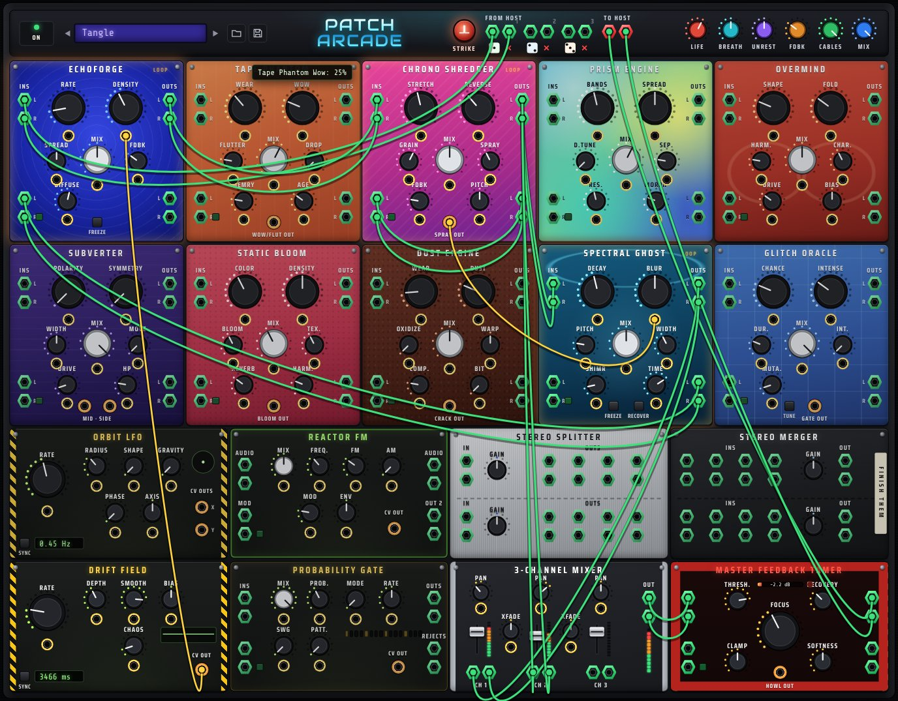

# Patch Arcade (browser edition)

A tangled feedback instrument with no generator. Eighteen effect, modulation and utility modules
sit behind one front panel and are wired together with virtual cables. It runs entirely in the
browser: the DSP engine is a single AudioWorklet, and the interface follows the *Patch Arcade*
manual and the *Best Practices for Browser-Based Patch UIs* brief.

## No input

Most synthesizers are generators plus shapers: an oscillator makes a waveform, and filters and
envelopes carve it. This rack has no generator. **Strike** injects one single-sample impulse, once.
Everything after that is the system listening to itself through delay lines, filters and
nonlinearities. What you hear is a bounded feedback loop hunting for a stable configuration and
never quite finding one.

The controls don't shape a sound. They shape the conditions a sound must satisfy in order to
exist:

| Knob | Condition |
| --- | --- |
| **Life** | How strongly a loop sustains itself. Each feedback cable's gain may lean in up to a ceiling set by Life, and is compressed back as the loop's energy rises past a target. A loop whose own gain plus that ceiling reaches unity lives; one that can't fades. At 0 nothing is held: a strike rings out and dies. |
| **Breath** | How far and how slowly the target swells and recedes (about 9–34 s per breath, 3–24 dB deep). Each breath redraws its own length, depth and shape, so no two match. |
| **Unrest** | How soon a tone a loop has settled on is carved away. A tracking notch finds a resonance that has held steady, slowly cuts it, and lets go once the loop has moved on. |

A cable that closes a new loop strikes that loop once, as patching a real feedback cable would.
**Panic** clears every buffer, and the rack stays silent until the next Strike.



## Run it

| Option | How |
| --- | --- |
| Single file | Open `dist/patch-arcade.html` in Chrome, Edge, Firefox or Safari. It works from disk; nothing to install. |
| From source | `npm start`, then open <http://localhost:8080>. Any static server works. AudioWorklet needs `http://localhost` or `https://`. |

Press **Start audio** (or **Strike**, which starts audio first) and pick a factory patch from the
purple display. In 1–3 in the host bar default to **Impulse only**. The demo instruments, your
microphone or line input, or a looping audio file are optional, for using the rack as an effect.

```
npm install          # dev tooling only (esbuild)
npm test             # offline DSP + patching tests (node --test)
npm run build        # rebuild dist/patch-arcade.html
npm run test:e2e     # real-browser check of the live worklet output (needs Playwright)
```

## Playing

- **Patch:** drag from any jack to another. Valid targets light up and the rest dim. The rules
  are the manual's:
  - output to input only;
  - audio to audio and CV to CV;
  - one source per audio input (a new cable replaces the old one), except that To Host and CV
    inputs sum;
  - patching a left output into a left input auto-follows the right pair.
- **Remove a cable:** hold **Shift** (or toggle ✂) and click the cable. Double-clicking a jack
  clears all of its cables.
- **Knobs:**
  - drag up or down; hold Shift for fine control;
  - the mouse wheel and arrow keys also work, and double-clicking resets the knob;
  - the LED ring shows the value after CV modulation, and the pointer shows the knob's own setting.
- **Dice:** roll 2–4 effects into the route's mixer channel and add 1–2 modulators. On an
  Impulse-only route the roll always closes a loop (nothing else would ever sound), and the
  **Fdbk** knob sets the chance of extra tangle: an inner loop, and the chain listening to itself
  through its own CV outputs. On a route with input, Fdbk is the chance of a loop. A roll never
  touches hand-patched cables or another route's modules. The red ✕ clears the route.
- **Loops:** a cable that closes a loop throws sparks. Every module inside a loop glows and
  "ages" over about 20 s, which changes how it behaves, as described in the manual. A living
  loop's panels also glow with the energy circulating in it, and the Strike button glows with
  the whole rack's.
- **Patches:** click the purple patch display to browse 48 factory patches. The first 20 need
  no input: **Seeds** (single loops), **Ecosystems** (tangled networks that steer themselves),
  **Machines** (rhythmic and metallic) and **Drones**. Each sets its own Life, Breath and
  Unrest. The 28 **Input FX** patches use the rack as an effect for the demo instruments; they
  set Life to 0, so their loops only bloom while the input feeds them. ◀ ▶ step through the
  patches in order, and the folder/disk icons load or save `.json`. The current patch autosaves
  in the browser.
- **Solo:** the small square on each module shows only the cables touching that module.

## Signal integrity: no clipping, no hiss, no shrill highs

These protections are built into the engine and each is covered by a test.

**Gain staging and overload**
- Every host input passes a trim, DC/rumble filter and soft limiter. Mic and line inputs also
  pass a noise gate, so input self-noise never reaches the effects.
- Every module output is checked each block. NaN, Inf or runaway values reset that module instead
  of spreading through the rack, and outputs are soft-bounded.
- The Mix knobs use an equal-power crossfade that is compensated for correlation. It stays
  equal-power for unrelated signals but never exceeds unity when dry and wet are alike, which is
  the manual's "a crossfade cannot exceed unity". As a result, feedback loops through effects only
  grow when you push the Splitter or Merger gains, as the manual describes.
- Feedback inside effects (Echoforge, Spectral Ghost, Chrono Shredder, Tape Phantom) is
  low-passed, DC-blocked and soft-saturated, so even near-unity regeneration stays bounded.
- **Loop regulation.** Left alone, a loop either dies or ends in a saturated howl. Every
  feedback cable is regulated on its own (so a weak channel isn't starved beside a strong one):
  - its gain leans in up to the ceiling set by Life and is compressed back above the target
    energy, which Breath keeps moving;
  - a soft amplitude ceiling about 16 dB above the target catches overshoot within the sample,
    like the saturation in a real feedback oscillator. The regulator can therefore move gently,
    and even a loop that circulates every 1.3 ms never collapses from a sudden duck.
  - At Life 0 the input governor applies instead: a loop may bloom up to +3 dB above what feeds
    it and fades once the input stops. A Splitter or Merger gain past centre inside the loop
    (the manual's "loop throttle") still opens it into a bounded bloom.
- Everything leaves through the output chain, in this order:
  1. DC blocker and 20 Hz subsonic high-pass;
  2. 8th-order 15.5 kHz low-pass;
  3. Shrill Guard (see below);
  4. runaway leveler, a slow compressor that eases a loud patch down;
  5. silence gate;
  6. volume;
  7. 3 ms look-ahead brickwall limiter. The output never exceeds −1 dBFS, including with a
     +12 dB feedback loop driven by full-scale noise.

**Harsh highs and aliasing**
- Every distortion stage is oversampled with linear-phase half-band filters: Overmind runs at 4×,
  and Tape Phantom, Subverter, Static Bloom and the Merger soft-clip run at 2×. Dry paths are
  delay-compensated, so partial Mix settings never comb-filter.
- Wrap and fold shapes are band-limited curves, not hard discontinuities.
- Bit crushing and sample-rate reduction are followed by a fidelity low-pass.
- Resonance in Prism Engine is reduced at high frequencies and cannot self-oscillate above about
  2.5 kHz.
- Shimmer octaves are band-limited inside their loop.
- Audio on a feedback cable passes a "cable loss" band-pass (80 Hz – 6 kHz), so loops darken
  as they recirculate instead of fizzing, and can't sink into an inaudible sub-bass rumble.
- Delay-time glides in Echoforge and Spectral Ghost are slew-limited. A jumpy CV into Rate or
  Time bends the pitch by a few semitones at most; inside a loop, faster sweeps would scatter
  the tail into noise.
- On the output, an 8th-order 15.5 kHz low-pass removes ultrasonic junk. The **Shrill Guard**
  (adjustable in the host bar) is a dynamic high shelf. It cuts only sustained harshness above
  about 4.5 kHz and leaves normal material alone.

**Hiss**
- Dust Engine noise is pink and low-passed (5 kHz at most) and ducks under the music. A silence
  gate fades it out entirely when nothing is playing.
- Bit reduction is undithered, so digital silence stays silent. Loop aging costs Dust Engine at
  most 2 bits: deeper undithered quantisation inside a quiet, self-sustaining loop turns into
  a hiss floor.
- Panic resets every filter, hold and gate state in every module, so nothing left over can
  re-seed a loop. A test checks each module patched into itself.
- A master silence gate removes any residual floor below −80 dBFS. When nothing plays, the
  output is true digital zero. Tests check this for random dice patches with feedback
  loops in every route (at Life 0) and for a struck chain with no loop.
- Every no-input factory patch and random no-input dice rolls are tested for hiss (spectral
  flatness of the 2–10 kHz band) and for energy above 12 kHz.
- Overmind subtracts its transfer curve's value at the bias point, so a moving Bias,
  Harmonics or loop mutation cannot leak a signal out of silence.
- All demo instruments are band-limited: sines, PolyBLEP saws and Karplus-Strong.

**Clicks**
- Cables fade in and out over 12 ms. When only one side of a stereo input is patched, its
  signal is copied to the other side with the same fade, so adding or removing the second
  cable never clicks.
- Knobs and CV are smoothed per sample.
- Glitches, gates and stutters use short crossfades, and grains are Hann-windowed.
- Source switching crossfades.

## Architecture

```
index.html                 dev entry (ES modules, no build step)
src/spec.js                module/param/jack definitions shared by UI and engine
src/graph.js               loop detection, processing order, cable ancestry (route colours)
src/patch.js               patch model: patching rules, dice, (de)serialisation
src/presets.js             factory patches (each is rendered and checked in tests/presets.test.mjs:
                           no-input patches for 45 s, from one impulse)
src/dsp/worklet.js         AudioWorkletProcessor wrapper (never throws on the audio thread)
src/dsp/engine.js          64-sample block router, feedback edges, Strike, cable fades, host I/O
src/dsp/ecology.js         Life, Breath and Unrest: the conditions every loop must satisfy
src/dsp/master.js          output safety chain
src/dsp/modules/*.js       the 18 modules
src/dsp/util.js            filters, delay lines, half-band oversampler, PRNG
src/ui/*.js, styles.css    rack, knobs, faders, SVG cable layer
scripts/build.mjs          single-file build (esbuild)
tests/*.test.mjs           offline DSP, no-input and patching tests
```

The engine processes the rack in 64-sample batches, in depth-first order from the From Host
inputs. A cable that points backwards in that order is a feedback edge and carries the previous
batch, so a module patched into itself rings at about 750 Hz (1.3 ms) as the manual describes.
Modules that cannot reach To Host are skipped to save CPU.

A dense patch, with three dice routes and eleven active modules, uses about 40% of one CPU core
in Node/V8. Typical patches use much less.

## Browser notes

- Verified in Chromium (headless, via `npm run test:e2e`). It uses only standard Web Audio
  (AudioWorklet), so current Chrome, Edge, Firefox and Safari 14.1+ should all run it.
- Microphone input needs permission and a secure context. Use headphones to avoid acoustic
  feedback.
- The front-panel cables are the whole instrument. The hardware manual's "back panel" (routing to
  other Reason devices) has no browser equivalent; the host bar's inputs and output take its place.
